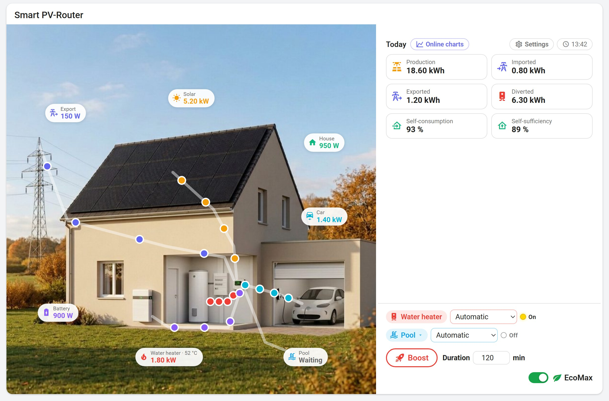

# Smart PV-Router by Smart Electromation Technology pour Home Assistant

[Français](#français) · [English](#english)

## Français

Intégration Home Assistant du **Smart PV-Router by Smart Electromation Technology**, routeur solaire conçu et
fabriqué en France par Smart Electromation Technology. Site officiel :
[smartelectromation.com](https://smartelectromation.com).

Elle lit le routeur sur le réseau local, sans cloud et sans broker MQTT : mesures, énergies du jour
pour le tableau de bord Énergie, modes des Sorties 1 et 2, Boost, et une carte animée de la maison.

**Le routeur est ouvert** : en Gradation manuelle, c'est Home Assistant qui fixe la puissance de
chaque sortie. Vous pouvez donc **écrire les automatisations que vous voulez** (prix spot, heures
creuses, batterie, prévisions...). Un exemple est fourni pour démarrer :
[Piloter le routeur par une automatisation](#piloter-le-routeur-par-une-automatisation).

Comme elle passe par HTTP, le routeur garde sa liaison MQTT avec le serveur Smart Electromation : le
tableau de bord en ligne (Grafana) et le suivi par smartelectromation.com restent disponibles.

*Page « Smart PV-Router » dans Home Assistant (exemple de valeurs).*

### Prérequis

- Smart PV-Router avec le firmware **V12_36** ou plus récent.
- Home Assistant **2026.3** ou plus récent, sur le même réseau local que le routeur.

### Installation

1. Cliquez sur le bouton ci-dessus : la **Marketplace** de votre Home Assistant s'ouvre sur cette
   intégration. Cliquez sur **Installer**, puis sur **Redémarrer Home Assistant**.
2. Le routeur est **découvert tout seul** : Paramètres > Appareils et services > **Configurer**.
3. C'est tout : **« Smart PV-Router » apparaît dans la barre latérale**, avec la maison animée.

Si le routeur n'est pas découvert :

puis saisissez `pvrouter.local` ou l'adresse IP du routeur.

**Première installation par la Marketplace** : Home Assistant affiche d'abord un avertissement sur les
éléments créés par la communauté (à accepter), puis demande de connecter la Marketplace à un compte
GitHub (gratuit) : saisissez le code affiché sur [github.com/login/device](https://github.com/login/device)
et validez. Cette connexion est demandée pour tout dépôt ajouté par lien, tant qu'il n'est pas dans le
catalogue de la Marketplace ; elle ne donne ni accès aux dépôts privés ni droit de modification.

Sans le bouton : ajout à la main dans la Marketplace

Paramètres > **Marketplace** > icône de lien (à droite de la recherche) : fenêtre **Ajouter grâce à un
lien GitHub** > adresse
`https://github.com/smartelectromation/smart-pv-router-homeassistant` > **Ajouter**, puis **Installer**.

Home Assistant antérieur à 2026.11 : HACS

Avant la version 2026.11, la Marketplace n'existe pas : le bouton ci-dessus ouvre HACS. Cliquez sur
**Télécharger**, puis redémarrez Home Assistant. Sans le bouton : HACS > menu **⋮** > **Dépôts
personnalisés** > adresse du dépôt, catégorie **Intégration**, puis **Télécharger**.

Sans Marketplace ni HACS : installation manuelle

1. Téléchargez `smart_pv_router.zip` dans la [dernière version](https://github.com/smartelectromation/smart-pv-router-homeassistant/releases/latest).
2. Décompressez-le dans `config/custom_components/smart_pv_router/` (avec le module complémentaire
   Samba ou Studio Code Server), puis redémarrez Home Assistant.

Les mises à jour ne sont alors pas proposées : il faut refaire la copie à chaque version.

### Entités

| Type | Entités |
|---|---|
| Puissances | réseau (+ soutirée / − injectée), injectée, production solaire, routée, Sortie 1, Sortie 2, maison, batterie, borne VE |
| Énergies du jour (kWh) | soutirée au réseau, injectée au réseau, solaire produite, routée, solaire routée |
| Autres mesures | tension, courants, autoproduction et autoconsommation du jour, rendement du routage, température du chauffe-eau, Boost restant, état de la voiture, heure du routeur |
| États | Sortie 1 / Sortie 2 active, charge saturée, période de nuit, cycle anti-bactéries |
| Commandes | mode de la Sortie 1 et de la Sortie 2 (Arrêt, Automatique, Marche forcée, Gradation, Gradation manuelle), Boost, EcoMax |
| Configuration | durée du Boost, écran, température de relance, plages horaires 1 et 2 (début, fin), puissance de délestage, Seuil Auto, Cible Modulation, relance réseau Sortie 2 |
| Désactivées par défaut | signal WiFi, température RTC, MQTT connecté, redémarrage, calibration de la Sortie 2 |

Seules les entités que le firmware fournit sont créées : certaines dépendent des options du routeur
(production, batterie, borne VE, sonde de température, EcoMax, 2e plage horaire). La durée du Boost et
l'écran demandent un firmware qui annonce la version de son API (clé `API` de `/getjson`) ; les plages
horaires, le délestage, le Seuil Auto, la Cible Modulation et la relance réseau Sortie 2 demandent
`API` 2 ou plus. Sans sonde, la température du chauffe-eau est « inconnue ».

Les réglages sont dans la fiche de l'appareil, carte **Configuration** : bouton **Réglages** de la page
Smart PV-Router (administrateurs), ou Paramètres > Appareils et services > Smart PV-Router.

### Carte Smart PV-Router

Elle s'affiche dans la barre latérale (**Smart PV-Router**) dès que le routeur est ajouté. Pour la
mettre aussi dans un de vos tableaux de bord : **Modifier** > **Ajouter une carte** > « Smart PV-Router ».

- Photo de la maison, avec la batterie et la voiture si le routeur les mesure.
- Flux d'énergie animés entre le routeur et le solaire, le réseau, le chauffe-eau, la Sortie 2, la
  batterie et la borne VE ; pastilles avec la puissance de chacun.
- Mode et état de chaque sortie (voyant Arrêt / Marche / Saturée), EcoMax, Boost et sa durée,
  directement sur la carte.
- **Gradation manuelle** (mode 4 du routeur) : choisissez ce mode pour une sortie, un curseur de 0 à
  100 % apparaît dessous. Cliquez sur la valeur pour en saisir une précise (ex. 54,7), puis Entrée. Le
  bouton **Automatiser** importe un exemple d'automatisation, à adapter à vos besoins : voir
  [Piloter le routeur par une automatisation](#piloter-le-routeur-par-une-automatisation).
- Boutons **Suivi graphique** (tableau de bord en ligne Smart Electromation Technology, adresse
  modifiable dans Configurer) et **Réglages**.
- **Charge de la Sortie 2** au choix (radiateur, piscine, spa, voiture Green'Up, pompe à chaleur,
  second chauffe-eau, climatisation, prise) : clic sur « Sortie 2 » sous la photo, ou Paramètres >
  Appareils et services > Smart PV-Router > **Configurer**. L'icône et le nom suivent partout.

La puissance de chaque sortie est déduite de la puissance routée, mesure commune aux deux sorties : la
Sortie 1 prend jusqu'à la puissance de sa charge, le reste va à la Sortie 2 (même calcul que
l'application et le tableau de bord en ligne).

### Tableau de bord Énergie

| Rubrique | Entité |
|---|---|
| Consommation réseau | Énergie soutirée au réseau |
| Retour au réseau | Énergie injectée au réseau |
| Production solaire | Énergie solaire produite |
| Appareil individuel | Énergie routée |

Les compteurs du routeur repartent de zéro chaque jour à 6 h : Home Assistant le gère.

### Piloter le routeur par une automatisation

Le routeur est ouvert. En **Gradation manuelle** (mode 4), ce n'est plus lui qui décide de la
puissance envoyée à la sortie : c'est Home Assistant, donc **vous**. Écrivez les automatisations que
vous voulez, avec toutes les données de votre maison, par exemple :

- chauffer l'eau quand le prix spot est bas ou négatif, ou pendant les heures creuses ;
- garder le surplus pour la batterie, la voiture ou un autre appareil avant le chauffe-eau ;
- tenir compte des prévisions solaires, de la température, de la présence ;
- répartir la puissance entre la Sortie 1 et la Sortie 2 selon vos priorités.

**Le principe tient en une action** : `number.set_value` sur l'entité « Gradation manuelle Sortie 1 »
(ou Sortie 2), avec une valeur de 0 à 100, au dixième près, la sortie étant en Gradation manuelle
(`manual_dimmer`).

#### Un exemple pour démarrer : annuler le surplus solaire

Pour montrer le principe, ce blueprint refait dans Home Assistant la régulation du routeur : à chaque
mesure du réseau (toutes les 5 secondes), il monte la gradation de la sortie quand le surplus part au
réseau et la baisse quand la maison soutire.

> **Ce n'est qu'un exemple.** Copiez-le, modifiez-le, ajoutez vos propres conditions, ou écrivez vos
> automatisations de zéro : le routeur fera ce que vous lui demanderez.

1. Cliquez sur le bouton ci-dessus (ou sur **Automatiser** sous la sortie, sur la carte), puis
   **Importer le blueprint**.
2. Créez l'automatisation à partir du modèle : choisissez « Puissance réseau », « Mode Sortie 1 » et
   « Gradation manuelle Sortie 1 », et indiquez la puissance de la charge (ex. 2000 W pour le
   chauffe-eau).
3. Sur la carte, passez la sortie en **Gradation manuelle** : l'automatisation prend la main. Remettez
   la sortie en **Automatique** pour rendre la main au routeur.

#### À savoir

- L'exemple n'agit qu'en Gradation manuelle et ne change jamais le mode lui-même.
- Le mode d'une sortie est enregistré dans la mémoire du routeur : changez-le de temps en temps, pas en
  boucle. Pour une régulation fréquente, faites varier la gradation manuelle, prévue pour cela.

### Bon à savoir

- Le routeur est interrogé toutes les 5 secondes.
- Un seul Smart PV-Router par installation.
- **Découverte MQTT** : si le routeur est déjà dans Home Assistant par la découverte MQTT, il y apparaît
  une seconde fois avec l'intégration. Les deux fonctionnent ensemble, mais n'utilisez qu'une seule des
  deux sources dans le tableau de bord Énergie.
- **Version MQTT** : cette intégration lit le routeur en HTTP. Pour passer par un broker MQTT, il existe
  [PvRouter NRI](https://github.com/nri04/ha-pvrouter-nri), développée indépendamment et non éditée par
  Smart Electromation Technology. Installées ensemble, les deux intégrations font apparaître le routeur
  deux fois.
- **Gradation manuelle** : le réglage n'agit qu'en mode Gradation manuelle. Avec un firmware plus ancien,
  qui ne renvoie pas cette valeur, Home Assistant affiche la dernière valeur envoyée.
- **Redémarrage** : il remet à zéro une partie des compteurs du jour.
- **Calibration de la Sortie 2** : elle coupe le routage, met la Sortie 2 en marche à pleine puissance
  le temps de la mesure, puis enregistre la puissance de la charge. À lancer seulement quand la charge
  peut consommer (chauffe-eau non coupé par son thermostat).
- Compatible avec [Solar Optimizer](https://github.com/jmcollin78/solar_optimizer) : modes des sorties
  et gradation manuelle.

### Support

Signaler un problème : [tickets du dépôt](https://github.com/smartelectromation/smart-pv-router-homeassistant/issues),
en joignant les diagnostics de l'intégration (Paramètres > Appareils et services > Smart PV-Router >
⋮ > Télécharger les diagnostics).

## English

Home Assistant integration for the **Smart PV-Router by Smart Electromation Technology**, a solar router designed
and made in France by Smart Electromation Technology. Official website:
[smartelectromation.com](https://smartelectromation.com).

It reads the router on your local network, with no cloud and no MQTT broker: measurements, daily
energy for the Energy dashboard, Output 1 and Output 2 modes, Boost, and an animated house card.

**The router is open**: in Manual dimmer mode, Home Assistant sets the power of each output. You can
therefore **write any automation you want** (spot price, off-peak hours, battery, forecasts...). An
example is supplied to get started:
[Control the router from an automation](#control-the-router-from-an-automation).

Because it uses HTTP, the router keeps its MQTT link to the Smart Electromation server: the online
dashboard (Grafana) and the follow-up by smartelectromation.com remain available.

*The "Smart PV-Router" page in Home Assistant (example values).*

### Requirements

- Smart PV-Router with firmware **V12_36** or later.
- Home Assistant **2026.3** or later, on the same local network as the router.

### Installation

1. Click the button above: the **Marketplace** of your Home Assistant opens on this integration.
   Click **Install**, then **Restart Home Assistant**.
2. The router is **discovered automatically**: Settings > Devices & services > **Configure**.
3. That's all: **"Smart PV-Router" appears in the sidebar**, with the animated house.

If the router is not discovered:

then enter `pvrouter.local` or the router's IP address.

**First install through the Marketplace**: Home Assistant first shows a warning about community content
(to accept), then asks you to connect the Marketplace to a (free) GitHub account: enter the code shown
on [github.com/login/device](https://github.com/login/device) and confirm. This connection is needed for
any repository added from a link, as long as it is not in the Marketplace catalog; it gives no access to
private repositories and no permission to make changes.

Without the button: add it by hand in the Marketplace

Settings > **Marketplace** > link icon (right of the search box): **Add from link** window > URL
`https://github.com/smartelectromation/smart-pv-router-homeassistant` > **Add**, then **Install**.

Home Assistant before 2026.11: HACS

Before 2026.11 there is no Marketplace: the button above opens HACS. Click **Download**, then restart
Home Assistant. Without the button: HACS > **⋮** menu > **Custom repositories** > repository URL,
category **Integration**, then **Download**.

Without Marketplace or HACS: manual installation

1. Download `smart_pv_router.zip` from the [latest release](https://github.com/smartelectromation/smart-pv-router-homeassistant/releases/latest).
2. Unzip it into `config/custom_components/smart_pv_router/` (with the Samba or Studio Code Server
   add-on), then restart Home Assistant.

Updates are then not offered: copy it again for each release.

### Entities

| Type | Entities |
|---|---|
| Power | grid (+ import / − export), export, solar, diverted, Output 1, Output 2, house, battery, EV charger |
| Daily energy (kWh) | grid import, grid export, solar, diverted, solar diverted |
| Other measurements | voltage, currents, self-sufficiency and self-consumption today, diversion efficiency, water heater temperature, Boost remaining, car state, router time |
| States | Output 1 / Output 2 active, load saturated, night period, anti-bacteria cycle |
| Controls | Output 1 and Output 2 mode (Off, Automatic, Forced on, Dimmer, Manual dimmer), Boost, EcoMax |
| Configuration | Boost duration, display, night heating temperature, time slots 1 and 2 (start, end), load shedding power, auto threshold, dimmer target, Output 2 night heating from grid |
| Disabled by default | WiFi signal, RTC temperature, MQTT connected, restart, Output 2 calibration |

Only the entities provided by the firmware are created: some depend on the router's options
(production, battery, EV charger, temperature probe, EcoMax, second time slot). Boost duration and
display need a firmware that reports its API version (`API` key in `/getjson`); time slots, load
shedding, auto threshold, dimmer target and Output 2 night heating need `API` 2 or later. Without a
probe, the water heater temperature is "unknown".

Settings are on the device page, **Configuration** card: **Settings** button on the Smart PV-Router
page (administrators), or Settings > Devices & services > Smart PV-Router.

### Smart PV-Router card

It shows in the sidebar (**Smart PV-Router**) as soon as the router is added. To also put it on one of
your dashboards: **Edit** > **Add card** > "Smart PV-Router".

- Picture of the house, with the battery and the car if the router measures them.
- Animated energy flows between the router and the solar panels, the grid, the water heater, Output 2,
  the battery and the EV charger; a chip with the power of each.
- Mode and state of each output (Off / On / Saturated light), EcoMax, Boost and its duration,
  right on the card.
- **Manual dimmer** (router mode 4): choose this mode for an output and a 0 to 100 % slider appears
  below it. Click the value to type an exact one (e.g. 54.7), then Enter. The **Automate** button
  imports an example automation, to adapt to your needs: see
  [Control the router from an automation](#control-the-router-from-an-automation).
- **Online charts** button (Smart Electromation Technology online dashboard, address editable in
  Configure) and **Settings** button.
- **Output 2 load** of your choice (radiator, pool, hot tub, Green'Up car, heat pump, second water
  heater, air conditioning, socket): click "Output 2" below the picture, or Settings > Devices &
  services > Smart PV-Router > **Configure**. The icon and name follow everywhere.

The power of each output is derived from the diverted power, a single measurement for both outputs:
Output 1 takes up to the power of its load, the rest goes to Output 2 (same calculation as the app and
the online dashboard).

### Energy dashboard

| Section | Entity |
|---|---|
| Grid consumption | Grid import energy |
| Return to grid | Grid export energy |
| Solar production | Solar energy |
| Individual device | Diverted energy |

The router's counters restart from zero every day at 6 am: Home Assistant handles it.

### Control the router from an automation

The router is open. In **Manual dimmer** mode (mode 4), the router no longer decides the power sent
to the output: Home Assistant does, so **you** do. Write any automation you want, using all the data
of your home, for example:

- heat water when the spot price is low or negative, or during off-peak hours;
- keep the surplus for the battery, the car or another appliance before the water heater;
- take solar forecasts, temperature or presence into account;
- share power between Output 1 and Output 2 according to your priorities.

**It all comes down to one action**: `number.set_value` on the "Manual dimmer output 1" (or output 2)
entity, with a value from 0 to 100, to a tenth, the output being in Manual dimmer mode
(`manual_dimmer`).

#### An example to get started: cancel the solar surplus

To show the principle, this blueprint rebuilds the router's own regulation in Home Assistant: on each
grid reading (every 5 seconds), it raises the output's dimmer when surplus is exported and lowers it
when the house imports.

> **It is only an example.** Copy it, change it, add your own conditions, or write your automations
> from scratch: the router will do what you ask.

1. Click the button above (or **Automate** below the output, on the card), then **Import blueprint**.
2. Create the automation from the blueprint: choose "Grid power", "Output 1 mode" and "Manual dimmer
   output 1", and enter the load power (e.g. 2000 W for the water heater).
3. On the card, set the output to **Manual dimmer**: the automation takes over. Set the output back
   to **Automatic** to hand control back to the router.

#### Good to know

- The example only acts in Manual dimmer mode and never changes the mode itself.
- An output's mode is stored in the router's memory: change it now and then, not in a loop. For
  frequent regulation, vary the manual dimmer, which is meant for it.

### Good to know

- The router is polled every 5 seconds.
- One Smart PV-Router per installation.
- **MQTT discovery**: if the router is already in Home Assistant through MQTT discovery, it shows up a
  second time with the integration. Both work together, but use only one of the two sources in the
  Energy dashboard.
- **MQTT version**: this integration reads the router over HTTP. To go through an MQTT broker, there is
  [PvRouter NRI](https://github.com/nri04/ha-pvrouter-nri), developed independently and not published by
  Smart Electromation Technology. If both integrations are installed, the router shows up twice.
- **Manual dimmer**: only acts in Manual dimmer mode. With an older firmware, which does not report
  this value, Home Assistant shows the last value sent.
- **Restart**: it resets part of the daily counters.
- **Output 2 calibration**: it pauses diversion, switches Output 2 fully on while measuring, then
  stores the load power. Only run it when the load can draw power (water heater not cut off by its
  thermostat).
- Works with [Solar Optimizer](https://github.com/jmcollin78/solar_optimizer): output modes and manual
  dimmer.

### Support

Report a problem: [repository issues](https://github.com/smartelectromation/smart-pv-router-homeassistant/issues),
with the integration diagnostics attached (Settings > Devices & services > Smart PV-Router > ⋮ >
Download diagnostics).

---

© 2026 Smart Electromation Technology.

**Code** : licence [MIT](LICENSE). **Photos et captures de la carte, logo, icône et marques** « Smart PV-Router »
et « Smart Electromation Technology » : © Smart Electromation Technology, tous droits réservés, hors
licence MIT ; toute reproduction interdite sans autorisation écrite (voir [NOTICE](NOTICE)).

**Code**: [MIT](LICENSE) licence. **Card pictures and screenshots, logo, icon and the "Smart PV-Router" and "Smart
Electromation Technology" trademarks**: © Smart Electromation Technology, all rights reserved, not
covered by the MIT licence; no reproduction without written permission (see [NOTICE](NOTICE)).
